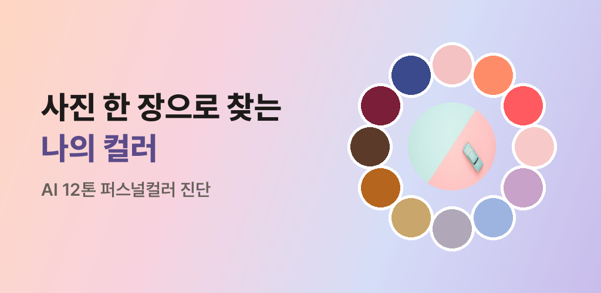
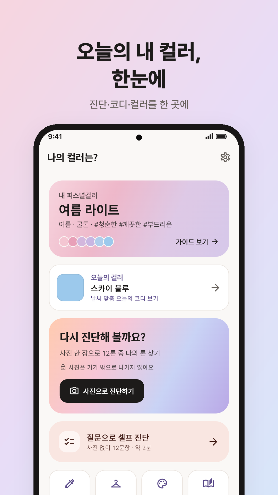
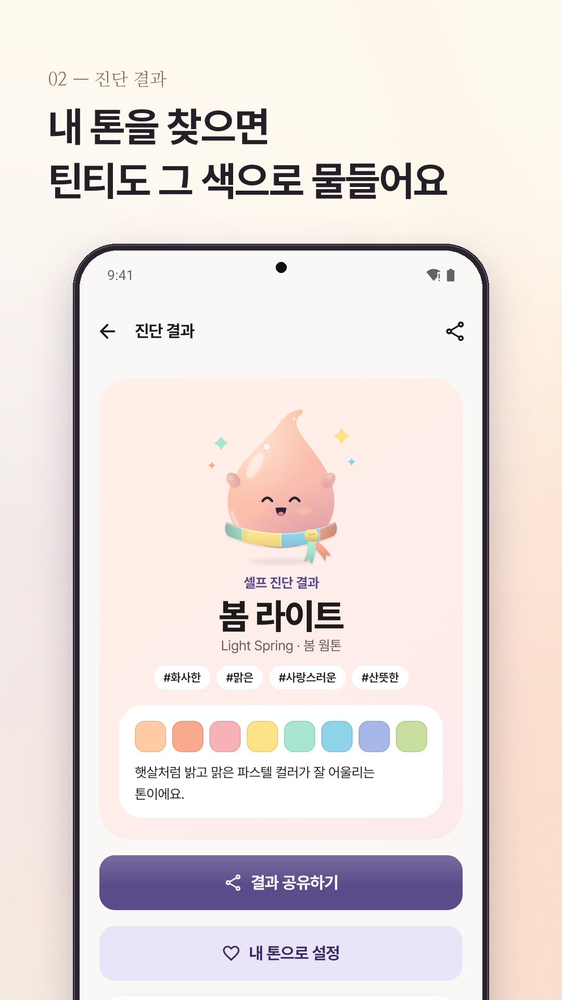
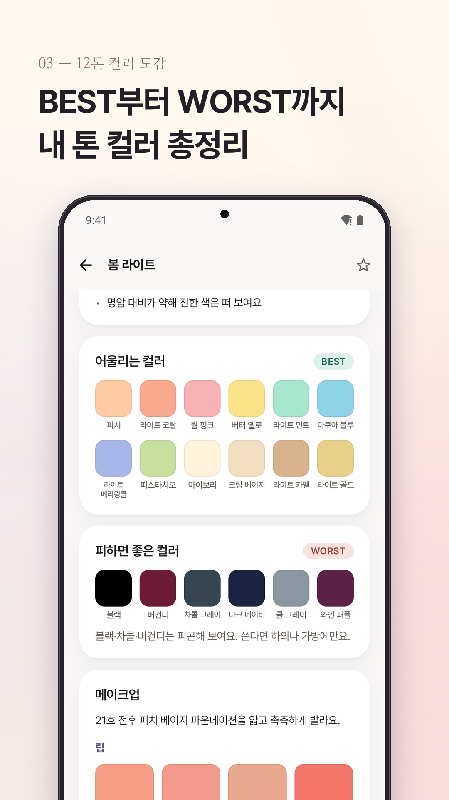
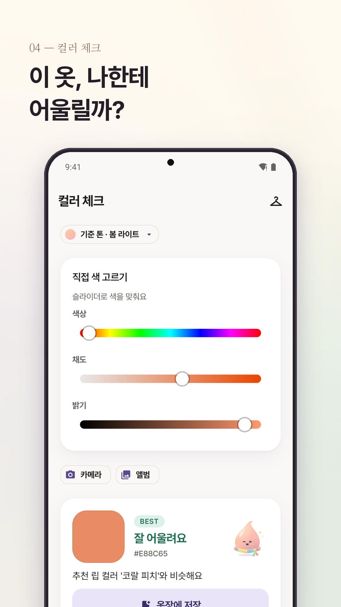
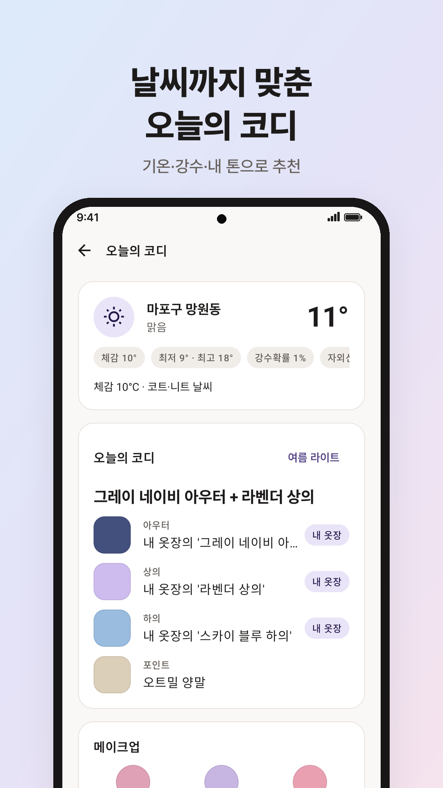
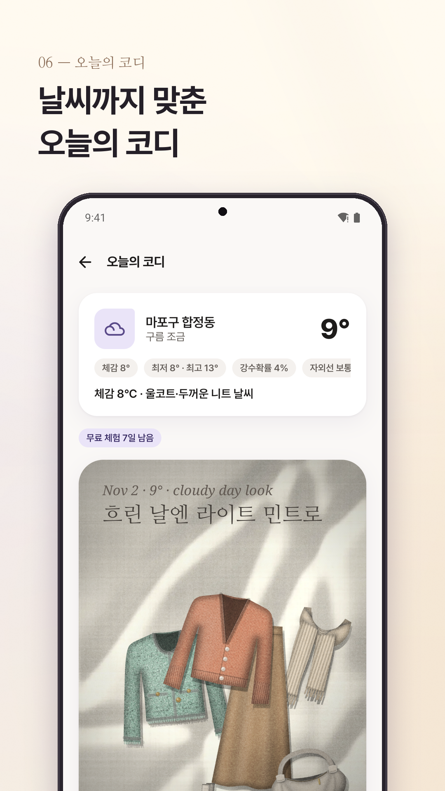
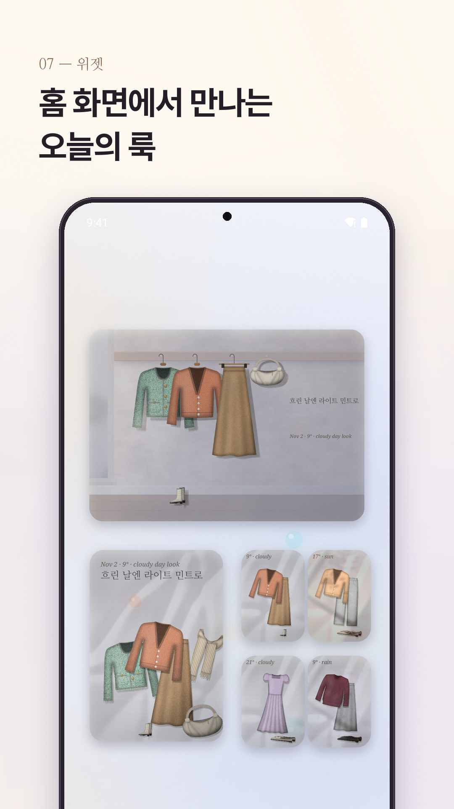
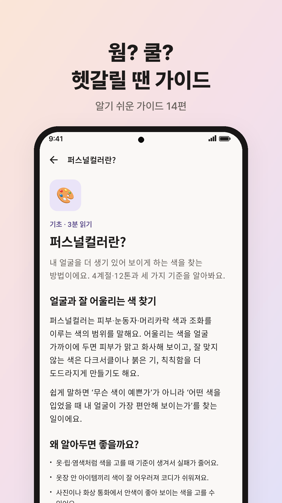

<div align="center">



# 나의 컬러는? - 퍼스널컬러

**사진 한 장으로 12톤 퍼스널컬러를 진단하고, 내 톤에 맞는 색·메이크업·코디를 매일 보여 주는 Android 앱**

### 📥 누적 다운로드 3만 회 이상 · 🏆 Play 뷰티 급상승 1위

<a href="https://play.google.com/store/apps/details?id=com.gun.personalcolor"></a>
<a href="https://tintycolor.com"></a>


</div>

<br>

## 📈 차트 기록 (2020 ~ 2021)

Google Play **뷰티 카테고리 인기 차트**에서 **급상승 1위**, **인기 앱 10위**에 올랐고, 지금까지 **누적 다운로드 3만 회 이상**을 기록했습니다.

<table align="center">
  <tr>
    <td align="center"><br><b>뷰티 · 급상승 1위</b></td>
    <td align="center"><br><b>뷰티 · 인기 앱 10위</b></td>
  </tr>
</table>

<br>

## 📱 화면

<table>
  <tr>
    <td align="center"><br><sub>퍼스널컬러 진단</sub></td>
    <td align="center"><br><sub>진단 결과</sub></td>
    <td align="center"><br><sub>12톤 컬러 도감</sub></td>
    <td align="center"><br><sub>컬러 체크</sub></td>
  </tr>
  <tr>
    <td align="center"><br><sub>내 옷장</sub></td>
    <td align="center"><br><sub>오늘의 코디</sub></td>
    <td align="center"><br><sub>오늘의 룩 위젯</sub></td>
    <td align="center"><br><sub>움직이는 배경화면</sub></td>
  </tr>
</table>

<br>

## ✨ 주요 기능

앱의 중심은 **퍼스널컬러**이고, 립·옷·코디는 진단된 톤에서 이어지는 콘텐츠입니다.
브랜드 캐릭터 **틴티(Tinty)** 는 진단 결과에서 내 톤 색으로 물드는 물감 방울이에요.

| | 기능 | 설명 |
|---|---|---|
| 📸 | **사진 진단** | 피부 4부위·머리카락·눈동자·입술 색을 측정해 12톤 중 내 톤을 찾습니다. 흰자위·흰 종이로 조명 색을 보정하고, 2~3장을 고르면 평균으로 더 꼼꼼하게 진단합니다. 얼굴과 빛이 맞으면 자동으로 찍히는 촬영 가이드 포함 |
| 📝 | **셀프 진단** | 사진 없이 질문 12개로 해 보는 진단 |
| 🎨 | **진단 결과 · 드레이핑** | 웜/쿨·밝기·선명도 분석, 비슷한 톤, 내 사진에 BEST/WORST 컬러를 대 보는 컬러 드레이핑과 립 체험, 리포트 이미지 저장·카카오톡 공유 |
| 📚 | **12톤 컬러 도감** | 톤별 BEST/WORST 컬러, 메이크업·헤어·코디 팁, 두 톤 나란히 비교, 즐겨찾기 |
| 🔍 | **컬러 체크** | 옷이나 립을 찍고 확인할 곳을 누르면 "잘 어울려요 / 무난해요 / 피하는 게 좋아요"로 판정 |
| 👗 | **내 옷장** | 옷을 찍으면 배경을 지우고 옷만 저장, 내 톤 기준 BEST·무난·WORST로 정리 |
| ☀️ | **오늘의 코디** | 내 톤·기온·비 소식·계절·내 옷장을 반영해 매일 새 코디와 그날의 립·아이·블러셔 컬러 추천 |
| 🏠 | **위젯 · 배경화면** | 홈 화면 "오늘의 룩" 위젯(1x1·2x2·4x2), 틴티가 사는 움직이는 배경화면, 매일 알림 |
| 📖 | **퍼스널컬러 가이드** | 웜/쿨 구별법, 진단 사진 잘 찍는 법, 계절별 스타일링 등 14편 |

**사진은 휴대폰 안에서만.** 얼굴 분석은 전부 기기 안에서 처리하며 사진을 서버로 보내지 않습니다. 회원가입 없이 바로 쓸 수 있고, 다크 모드와 태블릿을 지원합니다.

<br>

## 🛠 기술 스택

| 분야 | 사용 기술 |
|---|---|
| 언어 · UI | Kotlin, Jetpack Compose, Material 3 (adaptive · navigation suite) |
| 아키텍처 | 멀티 모듈(`app` · `core/*` · `feature/*`), Gradle 컨벤션 플러그인(`build-logic`), Hilt, Navigation Compose |
| 온디바이스 비전 | MediaPipe Tasks Vision(얼굴 랜드마크 · 사람 분리), ML Kit Subject Segmentation(옷 배경 제거), CameraX |
| 색 분석 | 순수 Kotlin 엔진(Lab 변환 · 화이트밸런스 · 12톤 분류) + 자체 학습 모델(`tools/model`) |
| 데이터 · 백그라운드 | DataStore, kotlinx.serialization, WorkManager, Open-Meteo 날씨(키 불필요) |
| 위젯 | AppWidgetProvider + RemoteViews (미리 렌더한 감성 장면 위에 코디 합성) |
| 수익화 · 배포 | AdMob + UMP, Play Billing(일회성 "프리미엄"), Play In-App Update · In-App Review, 카카오톡 공유 |

<br>

## 🗂 프로젝트 구조

```
app/            앱 셸, 내비게이션, 딥링크, 위젯 바인딩, 강제 업데이트
build-logic/    Gradle 컨벤션 플러그인
core/           model · analysis · vision · data · domain · designsystem · ui · ads · analytics · weather · share
feature/        onboarding · home · analyze · result · drape · quiz · tones · colormatch
                learn · my · settings · coordi · widget
tools/          진단 모델 학습 · 옷 그림 생성 · 감성 장면 생성 스크립트
store/          Play 스토어 등록 자료
```

모듈별 설명, 빌드·서명 방법, 광고·결제 정책, 꼭 알아야 할 주의 사항은 **[docs/DEVELOPMENT.md](docs/DEVELOPMENT.md)** 에 정리했습니다.

<br>

## 🕰 버전 히스토리

| 버전 | 내용 |
|---|---|
| **React Native** | 첫 버전. 인공지능 퍼스널 컬러 테스트 앱 → [personal_color_app](https://github.com/JungWooGeon/personal_color_app) |
| **Android v1** | 네이티브 Android로 전환. Kotlin · Hilt · WebView, [Teachable Machine](https://teachablemachine.withgoogle.com/) 기반 인공지능 테스트 + 자가진단 테스트 |
| **Android v2.0** | 전면 재작성. Compose 멀티 모듈, 온디바이스 얼굴 분석 12톤 진단, 틴티 캐릭터, 컬러 도감·컬러 체크·내 옷장, 오늘의 코디, 위젯·움직이는 배경화면 |

<details>
<summary><b>v1 화면 보기</b></summary>
<br>
<p>
  
  
  
  
</p>
</details>

<br>

## 🔗 링크

- Google Play: https://play.google.com/store/apps/details?id=com.gun.personalcolor
- 웹 · 결과 공유 페이지: https://tintycolor.com ([저장소](https://github.com/JungWooGeon/personalColor))
- 이전 버전(React Native): https://github.com/JungWooGeon/personal_color_app
